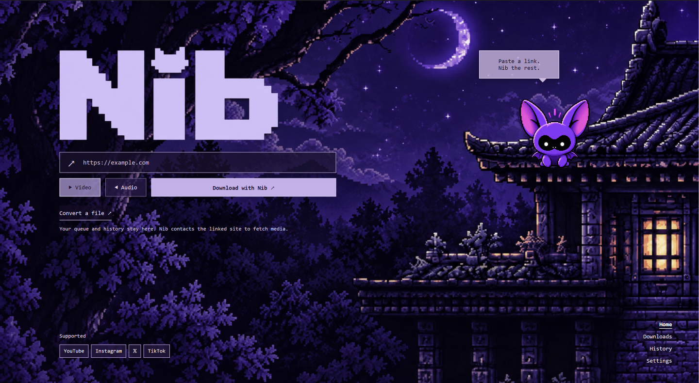
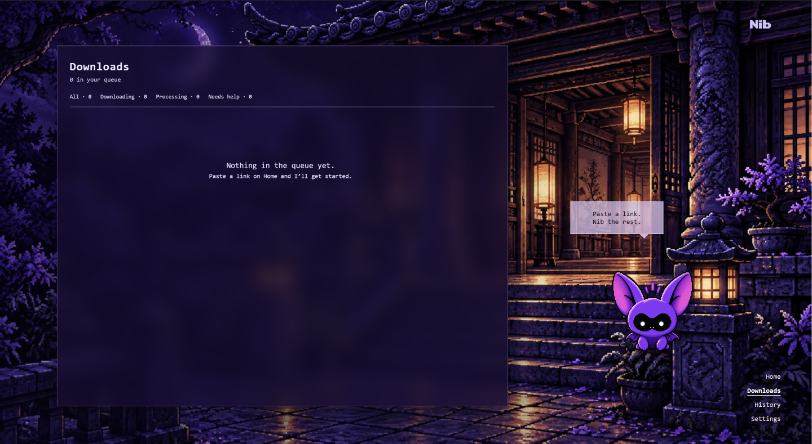
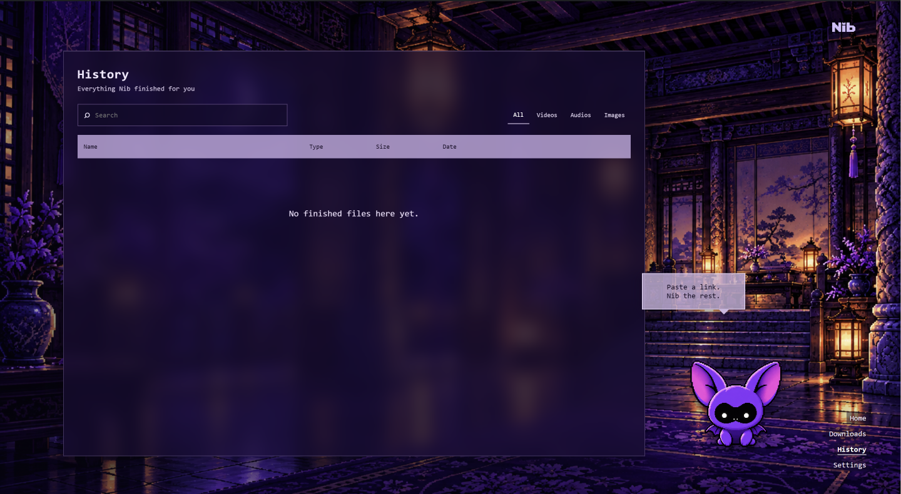

# Como baixar e usar o Nib

O Nib é um aplicativo para **Windows x64**. Você só precisa do instalador; não precisa usar o terminal, instalar Node.js ou configurar uma VPS.

## 1. Baixe o aplicativo

1. Acesse [github.com/lucassperess/nib/releases/latest](https://github.com/lucassperess/nib/releases/latest).
2. Role até **Assets** e clique no arquivo do Nib que termina em **.exe**. O arquivo começa a baixar.
3. Se você vir opções chamadas **Source code (zip)** ou **Source code (tar.gz)**, ignore-as: elas são para quem quer estudar o código, não para instalar o app.

## 2. Instale

1. Abra o instalador **.exe** do Nib na pasta Downloads do Windows.
2. Escolha a pasta de instalação, se quiser, e conclua o assistente.
3. Abra **Nib** pelo menu Iniciar. Se o Windows mostrar um aviso de segurança, confirme o nome e a origem do arquivo antes de continuar. Se não tiver certeza, pare e confira o link da release.

O Nib guarda suas preferências e o Histórico no seu perfil do Windows. Instalar uma versão mais nova não exige configurar tudo de novo. Seus arquivos baixados ficam na pasta escolhida em **Configurações**.

## 3. Faça o primeiro download

1. Acompanhe o tutorial curto do Nib. Você pode pulá-lo e repeti-lo em **Configurações → Ajuda → Repetir tutorial**.
2. Na **Home**, cole um link de mídia. Escolha **Vídeo** ou **Áudio** e clique em **Baixar com Nib**.
3. Em **Downloads**, veja o andamento em bytes, pause ou cancele se precisar. Quando o site fornecer o tamanho total, o Nib mostrará também o total e a porcentagem.
4. Abra **Histórico** para encontrar o arquivo concluído e abrir o arquivo ou sua pasta.

Para converter um arquivo que já está no computador, use **Converter arquivo** na Home, escolha o formato e acompanhe a tarefa em Downloads. O original é preservado. O tutorial também mostra onde importar uma sessão privada quando um site exigir acesso à sua conta; isso é opcional para links públicos.

### Se o site pedir uma sessão da sua conta

Em **Configurações → Sessões privadas**, escolha o serviço e use **Abrir pasta da extensão**. No Chrome ou Brave, abra a página de extensões, ative o modo de desenvolvedor e carregue essa pasta **sem compactação**. De volta ao Nib, clique em **Gerar código de conexão**. Abra a extensão, selecione o mesmo serviço e envie a sessão com o código exibido. O navegador pedirá permissão para ler os cookies desse site. O código expira em cinco minutos. A extensão é opcional, não está publicada em loja e não guarda cópias dos cookies; a importação manual continua disponível.

## Se algo não funcionar

| Situação | Faça isto |
| --- | --- |
| O link não abre ou o site mudou | Tente um link direto. Depois, em Configurações, use **Atualizar extrator** e tente novamente. |
| O download falhou | Em Downloads, leia a mensagem e use **Tentar novamente**. Não é necessário reinstalar o Nib. |
| O site pede login | Use somente uma sessão da sua própria conta em Configurações → Sessões privadas. |
| Não sabe onde o arquivo foi salvo | Abra o item em Histórico e clique em **Abrir pasta**. |
| Não quer mais uma tarefa com erro | Clique em **Remover** na tarefa em Downloads. Isso não apaga arquivos já concluídos. |

O Nib não contorna DRM. A disponibilidade de cada mídia depende do serviço de origem e das permissões da sua conta.

---

# Download and use Nib

Nib runs on **Windows x64**. No terminal, Node.js, or VPS is needed.

1. Open the [latest GitHub release](https://github.com/lucassperess/nib/releases/latest). Under **Assets**, download the Nib **.exe** installer, not the Source code archive.
2. Run the installer and open **Nib** from the Start menu. If Windows shows a security warning, verify the file name and release source before proceeding.
3. Follow or skip the five-step tour. You can replay it under **Settings → Help → Replay the tour**.
4. On Home, paste a media link, choose **Video** or **Audio**, and click **Download with Nib**. Follow the task in Downloads and open completed files from History.
5. **Convert a file** on Home works with a local file and preserves the original. Private sessions are optional and only needed when a site requires access to your account.

For a private session, open **Settings → Private sessions → Open extension folder**. In Chrome or Brave, enable developer mode and **Load unpacked** with that folder. Choose a service in Nib and generate a connection code. Open the extension, choose the same service, enter the code and send the session. The code expires after five minutes. The extension is optional and is not yet published in a store.

For errors, read the message in Downloads and use **Retry**. Updating Nib preserves its local preferences and History. The [README](../README.md) includes troubleshooting and development details.
